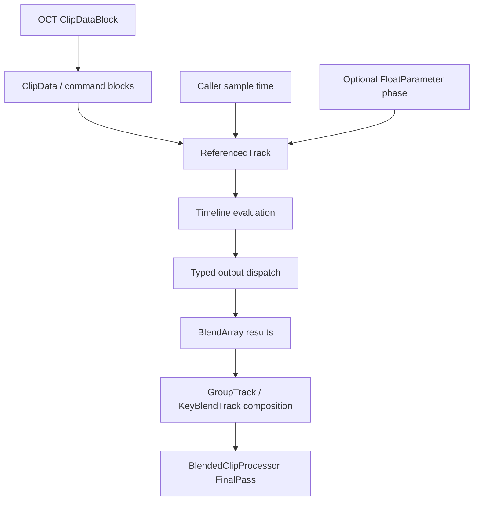

# Wii U symbols supporting the Octane Character Viewer — 2026-10-24

This pass uses the actual Disney Infinity 3.0 Wii U game.consumer.rpx, SHA-256 6bf0ee2a6a886d36952d7ac66490a5f9b17cb7e04b6fe1ab71b885a81d39fe76. This is not the Wii executable. Addresses are Wii U link/virtual addresses. They cannot be used as PC EXE addresses or Cemu host-memory offsets.

This is static executable inspection plus structural validation of an archive-extracted Wii U clip. It does not execute the PowerPC animation engine, alter viewer playback, or claim full game parity. Existing PC full-palette previews and the separate AssetWiiUdio mesh/eye experiments remain distinct projects.

## Confirmed control flow

The top-level BlendedClipProcessor calls UpdateDuration, GetTimeValue, BlendArray.Reset, GroupTrack.Compute and FinalPass. A direct ClipProcessor instead evaluates curves and dispatches into typed data nodes before marking outputs valid. These are separate paths; do not treat a referenced track as a complete actor controller.

## Findings from inspected instructions

| Wii U address | Symbol / role | Confirmed behavior and practical use |
|---|---|---|
|0x023283A4|BlendedClipProcessor::Compute|Named top-level blend path; graph evaluation precedes FinalPass. Helps identify which runtime stage a comparison measures.|
|0x02327C24|BlendedClipProcessor::UpdateDuration|Computes group duration, then optionally adjusts the linked time controller range while preserving phase.|
|0x02381648|GroupTrack::ComputeWeightsAndDuration|Takes the maximum child duration, starting from0. It does not duration-weight the group by layer weights.|
|0x0238181C|GroupTrack::Compute|Processes children with weight above0.001; pushes an intermediate result, computes the child at the passed time, then pops with that child’s weight, mode and mirror pointer.|
|0x02381E30|KeyBlendTrack::ComputeWeightsAndIndices|Uses optional FloatParameter.GetPhase, otherwise stored scalar; chooses neighboring keyed children and interpolation fraction. Exact duplicate-key and out-of-range semantics require dedicated native fixtures before reuse.|
|0x0238216C|KeyBlendTrack::ComputeWeightsAndDuration|Duration starts at first selected child; when alpha>0, interpolates toward the second duration: D=D0+alpha*(D1-D0).|
|0x0238221C|KeyBlendTrack::Compute|For D>0 uses normalized time t/D, then samples selected child i at (t/D)*Di. For nonpositive D uses phase1. If alpha<=0.001, computes only first child; otherwise first is popped with weight1, then second with alpha. Do not replace this sequential operation with two arbitrary additive contributions.|
|0x023847B8|ReferencedTrack::Compute|May replace incoming sample time with rangeStart+parameterPhase*range. Dispatches initial/static commands, evaluates timelines, then dispatches evaluated commands; mirror has a distinct path.|
|0x023808B8|FloatParameter::GetPhase|Returns1 when stored range denominator is exactly0; otherwise clamps (value-start)/range to[0,1]. Zero range therefore does not mean phase0.|
|0x0231DA3C|BaseClipProcessor::GetTimeValue|Reads its connected data node through a virtual getter; missing time input returns0.|
|0x023801F8|BlendArray::Pop|Clamps weight to[0,1], chooses replace/add and mirrored/nonmirrored routines, decrements stack depth. Child field+4==0 supplies the replace selector in the inspected group/keyed calls; authored enum labels should be checked separately.|
|0x0232F9B0|ClipProcessor::Compute|Gets time, evaluates the selected command block and calls plain/mirrored output dispatch, then marks outputs valid.|
|0x022EC4F8|ClipData::GetCommandBlock|Uses count at block+8 and command offsets at block+0x10. Separates command-block pointers from timeline pointers.|
|0x0232F774|ClipProcessor::ComputeTimelinesAndEvaluateCurves|Uses timeline offsets after the command-block offset array; switches on flags&0x3C0 into 12 named evaluator variants.|

Constants read from the executable:0x10034378=1,0x1003437C=0,0x10034380=0.0010000000474974513. Duration/interpolation and branch descriptions above are instruction-level findings, not numerical game-runtime tests. AdjustRangeWithoutChangingPhase includes range/exponent guards and UpdateBoundaries; only its ordinary phase-preservation path is described here, not all boundary modes.

## Real source-file check

CRC-extracted characters/fro_elsa/motions/elsa_bm_idle_specific01.oct from the matching Wii U character archive. ClipDataBlock SHA-256 122f5851199b14e14a05a87403c765566dd0873a49570bef872ec1c0f4072e51.

-18804 bytes, time range0..5.066666603088379.
-1command block,72timelines,127scalar registers.
-Float pool at18544,65float values.
-All72 curves use dispatch flags0 (CICD). Header dimensions are (word>>10)&0x3FF and segments word>>20; this differs from the relationship/eyelid header’s component bit location.
-Command timeline map is a complete permutation; summed curve dimensions match127registers.
-All curve extents and knot order checked; quantized cubic controls finite and adjacent segments continuous within8quantization units or1e-6.
-Inspector exports start/mid/end raw cubic values per timeline. These are not final bone transforms, and the Python interpolation is not native PowerPC execution. Boundary behavior outside the curve domain is not generalized.

Run inspect_wiiu_clip.py WiiUClips/elsa_bm_idle_specific01.oct.clipdata elsa-idle-structure.json.

## Application to our PC viewer

1. Use the named Wii U routines as an independent behavioral reference for the existing PC sampler and graph dispatcher. The existing PC referenced sampler entry0x0059EB40 corresponds in role to Wii U ReferencedTrack::ComputeTimelinesAndEvaluateCurves at0x02384544; this role match comes from existing PC capture notes and the named Wii U function, not an address-offset conversion.
2. Prioritize automatic GroupTrack/KeyBlendTrack timing and child selection for broader motion families. Existing complete-palette coverage does not eliminate profile-specific scheduling/state fixtures.
3. Verify output-command port mapping and typed result initialization next, using source graph metadata. Static/default values must be dispatched as well as timed channels. Preserve typed channels instead of assuming every curve is a bone rotation.
4. Compare the same semantics against PC native-execution fixtures before changing production evaluator behavior. No arbitrary finger offsets or renewed finger captures are warranted by this pass.
5. Later, add Wii U clip support to the viewer only after command dispatch, source graph bindings, coordinate conventions and full palette composition are checked. The raw inspector alone is not playback support.

No Cheat Engine capture or running game is required for the next static mapping pass.

## Artifacts

- function-evidence-manifest.json: original function names, sizes, code SHA-256 and named direct call/branch targets.
- Address-named TXT files: annotated disassembly for 38 routines including curve variants.
- inspect_wiiu_clip.py and elsa-idle-structure.json: reproducible raw-file structural check and bounded samples.
- Existing PC context: OctaneCharacterViewer/NATIVE_ANKLE_VALIDATION.md, FULL_PALETTE_VIEWER_HANDOFF.md and REFERENCED_TIME_CAPTURE_HANDOFF.md.

